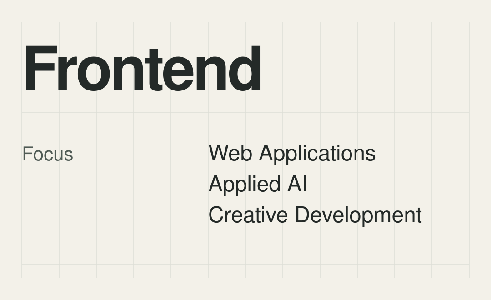

<picture>
  <source media="(prefers-color-scheme: dark)" srcset="./assets/frontend-grid-dark.svg">
  
</picture>

Frontend engineer with over two years of commercial development experience. I work on web applications, backend integration and AI-assisted development, with an interest in AI integrations and visually expressive interfaces.

### Selected work

**[Siverno](https://siverno.ru/)** — Engineering practice for software systems, AI integrations and automation.

**[Waystroke](https://waystroke.online/)** — Creative web studio for design and development.

### Tools & practice

**Frontend** — Angular, TypeScript **Backend** — PHP, Go, PostgreSQL **Environment** — Arch Linux **Workflow** — AI-assisted development

[Telegram](https://t.me/t2aa4) · [Email](mailto:mind.style11@gmail.com)
