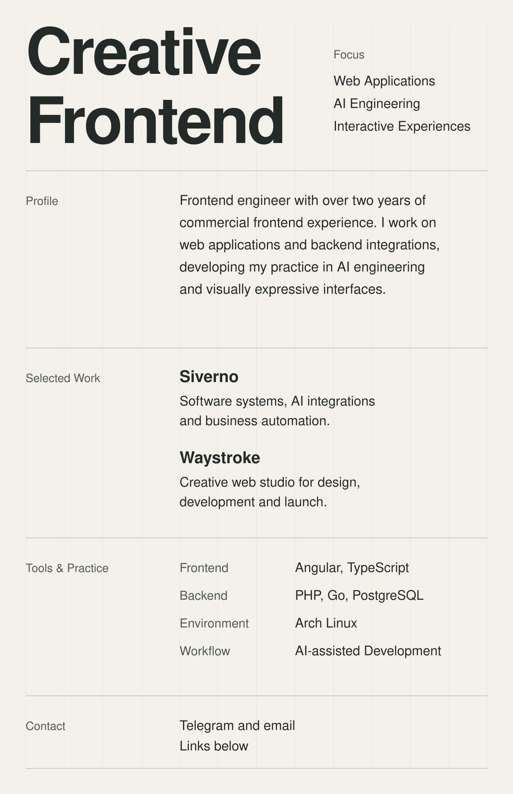

<picture>
  <source media="(prefers-color-scheme: dark) and (max-width: 600px)" srcset="./assets/profile-grid-mobile-dark.svg">
  <source media="(max-width: 600px)" srcset="./assets/profile-grid-mobile-light.svg">
  <source media="(prefers-color-scheme: dark)" srcset="./assets/profile-grid-desktop-dark.svg">
  
</picture>

**Projects** — [Siverno](https://siverno.ru/) · [Waystroke](https://waystroke.online/) **Contact** — [Telegram](https://t.me/t2aa4) · [Email](mailto:mind.style11@gmail.com)

Read the profile as text

### Creative Frontend

**Focus:** Web Applications · AI Engineering · Interactive Experiences

Frontend engineer with over two years of commercial frontend experience. I work on web applications and backend integrations, developing my practice in AI engineering and visually expressive interfaces.

### Selected Work

**[Siverno](https://siverno.ru/)** — Software systems, AI integrations and business automation.

**[Waystroke](https://waystroke.online/)** — Creative web studio for design, development and launch.

### Tools & Practice

**Frontend** — Angular, TypeScript **Backend** — PHP, Go, PostgreSQL **Environment** — Arch Linux **Workflow** — AI-assisted Development

**Contact** — [Telegram](https://t.me/t2aa4) · [Email](mailto:mind.style11@gmail.com)

