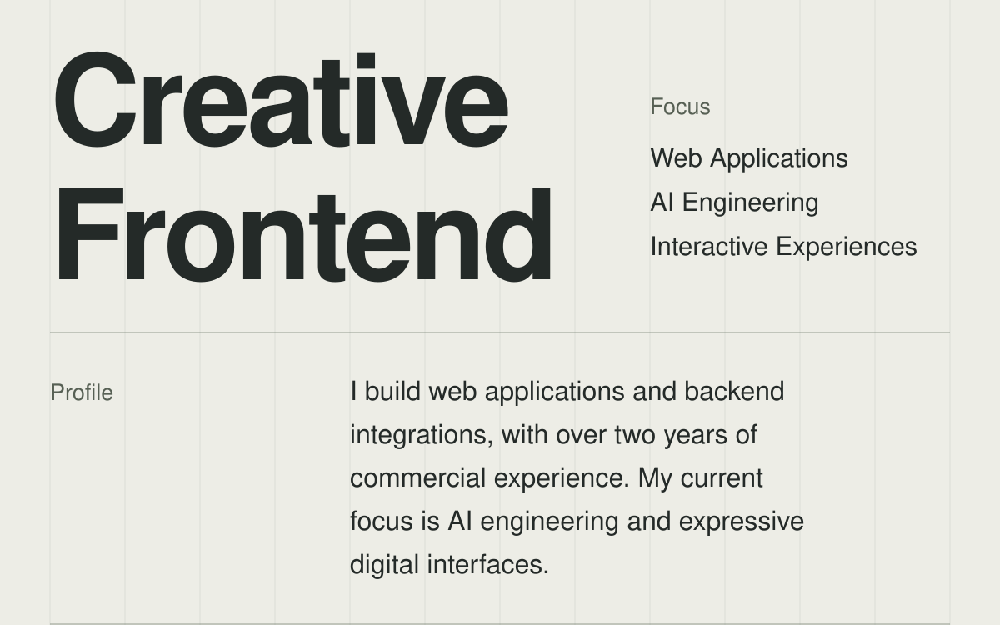
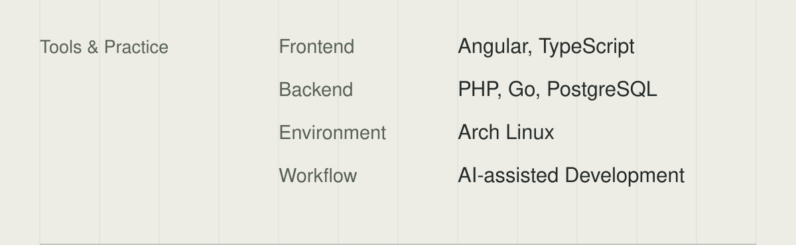

<picture><source media="(max-width: 600px)" srcset="./assets/intro-mobile-light.svg"></picture><a href="https://siverno.ru/"><picture><source media="(max-width: 600px)" srcset="./assets/siverno-mobile-light.svg"></picture></a><a href="https://waystroke.online/"><picture><source media="(max-width: 600px)" srcset="./assets/waystroke-mobile-light.svg"></picture></a><picture><source media="(max-width: 600px)" srcset="./assets/tools-mobile-light.svg"></picture><a href="https://t.me/t2aa4"><picture><source media="(max-width: 600px)" srcset="./assets/telegram-mobile-light.svg"></picture></a><a href="mailto:mind.style11@gmail.com"><picture><source media="(max-width: 600px)" srcset="./assets/email-mobile-light.svg"></picture></a>

